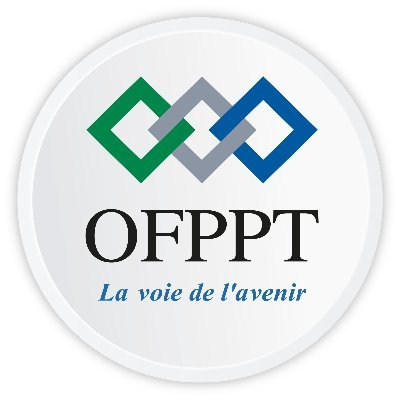

<!-- _class: cover -->

<div class="logos">
  
  
</div>

# EVENT TICKETING


**Prepared by:** Oussama Ech-Charef  
**Supervisor:** Fouad Essarraj

<!-- Speaker notes: Present the project title, learner, and supervisor. -->

---

<!-- _class: title -->

# INTRODUCTION

## About the project

Event Ticketing is a web platform for finding and booking event tickets.

It helps users:

- Discover events
- Read event details
- Book tickets online

---

<!-- _class: title -->

# PROJECT NEEDS

## Understanding the problem

---

# THE PROBLEM

## Difficulties with event booking

- Event information can be spread across many platforms.
- Users may not find the right event quickly.
- Paper tickets can be lost.
- Manual booking can take time.

---

# THE NEED

## A centralized ticket platform

The application provides:

- A clear event directory
- Categories for easy search
- Event details in one place
- Simple online booking

---

<!-- _class: background-demo -->

# EVENT PLATFORM

## One place for events and tickets

---

<!-- _class: title -->

# PROJECT ANALYSIS

## Requirements and main features

---

# MAIN REQUIREMENTS

## Three main entities

- **Event:** stores event information.
- **Category:** classifies events.
- **Organizer:** manages events.

The user searches events and creates bookings.

---

# MAIN FUNCTIONALITIES

## Basic management operations

1. **Create:** add an event or category.
2. **Read:** display event information.
3. **Update:** change event details.
4. **Delete:** remove an event.
5. **Book:** reserve one or more tickets.

---

# DATA ORGANIZATION

| Entity | Main information | Role |
|:---|:---|:---|
| Event | Title, date, place, price | Main event |
| Category | Name and description | Classify events |
| Organizer | Name and contact | Manage events |
| Booking | User, event, quantity | Reserve tickets |

---

<!-- _class: title -->

# PROJECT DESIGN

## Data structure and relationships

---

# DATABASE RELATIONSHIPS

## One-to-many relationships

- One organizer can create many events.
- One category can contain many events.
- One event can have many bookings.
- Each booking belongs to one user and one event.

---

# SIMPLIFIED DATA MODEL

```text
ORGANIZER 1 ───── creates ───── N EVENT
CATEGORY  1 ───── contains ─── N EVENT
EVENT     1 ───── has ───────── N BOOKING
USER      1 ───── makes ─────── N BOOKING
```

---

# BOOKING WORKFLOW

```text
Event list → Event details → Select tickets → Confirm booking
```

The flow keeps booking simple for the user.

---

<!-- _class: title -->

# PROJECT IMPLEMENTATION

## Technologies and prototype

---

# TECHNICAL STACK

| Technology | Purpose |
|:---|:---|
| HTML / CSS | Page structure and design |
| JavaScript | User interactions |
| PHP / Laravel | Backend application |
| SQLite / MySQL | Database |
| Eloquent ORM | Data relationships |
| Marp | Project presentation |

---

# EXAMPLE OF BOOKING DATA

```json
{
  "event": "Music Concert",
  "tickets": 2,
  "status": "confirmed"
}
```

---

<!-- _class: blue -->

# PROJECT PROTOTYPE

## Event platform interface

The prototype presents:

- Event list
- Event details
- Ticket booking

<!-- Speaker notes: Explain the image and the booking workflow. -->

---

<!-- theme: gaia -->

# MARP THEMES

## Gaia theme

Marp supports the `gaia` theme for a modern presentation style.

```yaml
theme: gaia
```

---

<!-- theme: uncover -->

# MARP THEMES

## Uncover theme

Marp also supports the `uncover` theme for a clean style.

```yaml
theme: uncover
```

---

<!-- theme: default -->

# PROJECT PROGRESS

## Main development activities

<!-- _class: fragments -->

- [x] Define events, categories, and organizers
- [x] Design the data model
- [x] Create the presentation prototype
- [ ] Build the booking interface
- [ ] Connect the database
- [ ] Test the application

---

# EXPORTATION

## Export the presentation

```bash
npx @marp-team/marp-cli lab-marp/prisontation.md --html
npx @marp-team/marp-cli lab-marp/prisontation.md --pdf
npx @marp-team/marp-cli lab-marp/prisontation.md --pptx
```

The Marp extension in VS Code can preview the slides.

---

<!-- _class: title -->

# CONCLUSION

## Project result and objective

---

# PROJECT CONCLUSION

The **Event Ticketing** project creates one clear platform for event booking.

It helps users:

- Find events faster
- Understand event details
- Book tickets more easily

**Final objective:** make event booking simple, organized, and accessible.

> A simple ticket journey makes every event easier to reach.

---

<!-- _class: title -->

# THANK YOU

## Thank you for your attention!

**Event Ticketing**  
**Oussama Ech-Charef**
